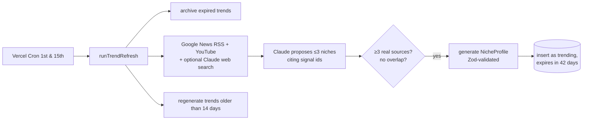

# subcult architecture

Key decisions and the trade-offs behind them. The README covers setup; this file covers _why_.

## Culture first, music as the soundtrack

subcult is a culture and fashion app (fits, archive pieces, brands, visual references, scenes)
with music as its soundtrack layer. Third-party content plays and opens **in-app** through each
platform's official surface (30s iTunes previews, Spotify's embed, YouTube's IFrame player,
eBay listings in our product sheet); external links are small secondary buttons. subcult never
re-hosts third-party media. The only content it stores is what people post themselves (fits),
which is why that layer comes with moderation, rate limits and metadata stripping.

## Data sources (verified October 2026)

| Section   | Source                                                             | Fallback when unavailable            |
| --------- | ------------------------------------------------------------------ | ------------------------------------ |
| Fits      | User posts (Supabase Auth + Storage), looks from the board         | Board imagery only                   |
| Archive   | eBay Browse API (client credentials), cached ≤6h                   | Tab says it's offline; nothing faked |
| Sounds    | iTunes previews (soundtracks), Spotify `/search` (≤10), embeds     | Search chips                         |
| Moodboard | Are.na public channels (no key), Unsplash, Pexels, own imagery     | Own imagery (album art, photos)      |
| Scene     | YouTube Data API v3, Google News RSS, subreddit deep links         | Deep links                           |
| Brands    | Taxonomy data (verified), eBay, Unsplash/Pexels                    | Description, niches, sourced artists |
| Follow    | Instagram handles verified by Wikidata + MusicBrainz / brand sites | Row hidden                           |

**Are.na:** search is Premium-only, so niches list curated public channels (checked readable as a
guest, 30 req/min). **Instagram:** profiles can't be checked by fetching them (same login wall
for real and fake handles), so handles need two independent sources; oEmbed needs Meta App
Review, so there are no Instagram embeds.

**Reddit: no fetcher.** Reddit closed self-service API access in November 2025, shut off
unauthenticated `.json` endpoints in May 2026, and stops accepting new public API requests on
31 October 2026. The Community tab is designed as deep-link cards (top of the week, search
within the subreddit) instead of fetched posts. Nothing to break, nothing to rate-limit.

**Spotify: search only.** February 2026 development-mode changes require the app owner to have
Premium, cap `/search` at `limit=10`, and remove artist top tracks, new releases and browse
categories (recommendations and related artists were already gone for new apps). The fetcher
uses Client Credentials plus `/search` exclusively, spreading the 10-result budget across the
profile's `spotifyQueries` and `artists`. Without keys, the Sounds tab renders search and
artist deep links from the same profile data.

**Shops.** Global stores only (Amazon, Depop, Etsy, ASOS, Grailed, Google Shopping). The Amazon
storefront is configurable with `AMAZON_DOMAIN` (default `amazon.com`), with an optional
`AMAZON_AFFILIATE_TAG`.

## Cache-first LLM

A niche profile is generated once, validated with Zod and stored forever, keyed by a normalized
slug. The 30 launch niches are hand-curated JSON in `/data/niches`, bundled with the app, so
they render even if the database is down and cost nothing. Claude is only called for
user-typed niches that don't exist yet.

## Budget guardrails

Designed to run for six months on free tiers plus a one-time $5 of API credit.

- **Global daily cap** on new LLM generations (`LLM_DAILY_GENERATION_CAP`, default 30), counted
  from the `llm_usage` ledger, checked before the per-IP limit. It fails closed: if the ledger
  can't be read, nothing is generated. Users see "the vibe machine is resting" with preset picks.
- **Ledger:** every LLM job (and failure) is a row in `llm_usage` with tokens, attempts, cost and
  duration. `/admin/usage` (HTTP Basic, `ADMIN_SECRET`) shows spend and the cap gauge.
- **Seeds are bundled:** the 30 curated niches ship in the app, so they render (and resolve in the
  API) even when Postgres is unreachable.
- **Keep-alive:** a daily Vercel Cron runs one cheap query so the free Supabase project never
  pauses.

## Trend engine

Every two weeks the catalog picks up niches that are emerging right now.

- **Evidence is enforced in code, not trusted from the model.** Claude cites signal ids; anything
  citing fewer than three real, distinct signals is rejected. Signal titles are fenced and treated
  as data, so a headline can't instruct the model.
- **Overlap detection** stems aesthetic suffixes ("-core", "girlies", "cowgirl/cowboy") and
  compares token sets against every existing slug and `relatedNiches`, so renamed variants of
  existing niches don't get published as "new".
- **Cost cap:** every LLM job reserves a conservative estimate against `TREND_RUN_MAX_COST_USD`
  (default $0.25) before running, so even concurrent jobs can't overshoot. Actual costs settle the
  reservation and land in `llm_usage`.
- **Lifecycle:** `kind` (evergreen | trending) and `status` (active | archived | hidden). Trends
  expire after `TREND_TTL_DAYS` (42) and become archived: reachable by URL, gone from Explore.
  Admins can hide any non-seed niche from `/admin/niches`.
- **Scheduling:** Vercel Hobby allows one cron run per day and 300s functions. A run (signals,
  one proposal call, three parallel generations, a few refreshes) fits comfortably; the pipeline
  also stops starting new jobs after 240s and leaves remaining refreshes for the next run. That
  keeps everything on Vercel, so the repo doesn't depend on GitHub Actions schedules, which GitHub
  disables after 60 days without activity.
- **No key, no problem:** without `ANTHROPIC_API_KEY` the cron route no-ops. The
  `/refresh-trends` Claude Code command does the same job by hand (web research → validated
  `data/trends/*.json` → `pnpm trends:upsert`).

## Live feeds, caching and ranking

Each niche page fans out to every configured source in parallel (`Promise.allSettled`), each
behind a 4s timeout and a Redis cache. A failing, slow or unconfigured source is reported and
skipped; the page always renders, and every tab falls back to curated deep links.

| Source  | API                                  | Fresh | Stale-if-error | Notes                                   |
| ------- | ------------------------------------ | ----- | -------------- | --------------------------------------- |
| News    | Google News RSS (no key)             | 1h    | 24h            | last 14 days                            |
| Spotify | Client Credentials + `/search` (≤10) | 24h   | 7d             | playlists by query, tracks by artist    |
| YouTube | Data API v3 `search`                 | 6h    | 3d             | 4-20 min only (no Shorts), daily budget |

**Cache:** Upstash Redis, key `subcult:feed:v3:<source>:<slug>`, value `{ value, fetchedAt }`.
Fresh entries are served directly; expired ones are refetched; if the refetch fails the stale copy
is served instead. A broken cache behaves like a miss, never an error. Without Redis, an in-memory
cache stands in.

**YouTube quota:** search costs 100 of 10,000 daily units, so a shared Redis counter caps feed
searches at 80/day. Past the cap the fetcher stops and the stale cache covers the gap.

**Ranking:** `score = relevance × recencyDecay × sourceWeight × (1 + feedbackBoost)`

- relevance = 0.4 + 0.6 × min(1, keyword hits / 2), with keywords from the niche's name, vibe
  words, artists and brands. News and videos with zero hits are demoted to 0.15.
- recencyDecay = 0.5 ^ (age / half-life): news 48h, video 7d; Spotify items are timeless (0.7).
- sourceWeight: Spotify 1.0, YouTube 0.9, news 0.8.
- feedbackBoost ∈ [-1, 1] from saves and "not my vibe" (Phase 6); −1 removes an item.

## Content mix (lib/feed/mix.ts)

Every feed page is built to target shares instead of "whatever the fetchers returned":
fashion 35% (fits, archive listings, brands), moodboard 20%, music 20%, video 10%, news 10%,
discovery 5%. Fashion niches lean further into fits and visuals; music never goes up anywhere.

- **Weighted interleave:** each slot goes to the kind furthest behind its target share, never a
  third of the same kind in a row.
- **Caps per 20-item window** ("any page"): music 20%, video 10%, news 15%, discovery 10%.
- **Redistribution:** a missing source's share goes only to the live visual kinds (fashion,
  moodboard), never to music. With no visual source live, capped kinds absorb a little and the
  feed ends short rather than being padded.
- `pnpm feeds:mix` prints target vs measured for For You and niches.

## Relevance pipeline and source tiers (lib/feed/clean.ts, source-tiers.ts)

Applied on read, so it also cleans cached items: spam (type beats, free beats, producer
tutorials, AI covers) → language/region (non-Latin scripts, Vietnamese, Romance function words,
regional compilations; non-English niches opt in) → per-niche negative keywords (niche data) →
source tier + entity match → dedupe (canonical URL, near-identical titles by token Jaccard).

- **Trusted sources** (per-branch allowlists of news domains and YouTube channels, verified):
  a verified entity or a multi-word niche phrase qualifies an item.
- **Unknown sources** need more: news must name an unambiguous verified entity; videos must come
  from the artist's own channel or credit them up front ("Artist - Song").
- Ambiguous words (opium, jerk, rage, vamp, plugg, glaive…) never qualify an item alone.
- Regression tests use the real junk that leaked into feeds; `pnpm feeds:audit` prints
  keep/drop decisions against the live cache.

## Content correctness: vision tagging (lib/vision)

External images (Are.na, Unsplash, Pexels) are classified by Claude Haiku 5.5 before they can
reach a feed: kind (fit / product / album-art / artist-portrait / moodboard / other), quality 1-5,
niche fit 0-1, dominant colors. URL image blocks, structured output, 6 images per request.

- Tags are cached per image URL hash for 90 days; each request is logged to `llm_usage`
  (purpose `vision-tag`) with its cost; `VISION_DAILY_BATCH_CAP` (default 60/day) is separate from
  the generation cap. `/admin/usage` shows per-feature spend and both caps.
- Without a key (or over the cap) nothing is tagged, and untagged external images stay on the
  Moodboard only. Fits = posted fits + images tagged `fit` with quality ≥3; quality <3 never leads
  a board; album art lives in Sounds.

## Fresh news (lib/feed/fetchers/news.ts, lib/sources/scene-feeds.ts)

Google News `when:7d` searched by the niche's entities: verified artists (scene niches only, so an
aesthetic like cottagecore never pulls Taylor Swift gossip), brands anchored to "fashion", then
the niche's own phrase. Seven scene outlets' RSS feeds (each checked live) add publisher images
and ledes. `onTopic` guards fashion niches against their artists' music news and one-word brand
names against homonyms. Each query gets its own share before the cap. Measured with
`pnpm news:freshness`: 40 → 87 headlines across 20 niches, median age 208h → 70h.

## Taste model (lib/taste)

**Why would I open this today?** Because it knows my taste. The taxonomy and verified entities
stay curated; what's learned is how much each person cares about each entity.

- **Entities:** `artist:slug`, `brand:slug`, `niche:slug`, `tag:slug`. Cards carry them (meta or
  their own ids); track credits split into artists (slugify matches all 375 verified artists).
- **Signals and weights:** play 1, play-through (≥25s of a 30s preview) 2, skip (<5s) −1, open 1,
  dwell (≥2s at ≥50% visible) 0.5, like 2, save 3, share 4, follow 5, vibe check 4 × share,
  not my vibe −5. A card's niche gets a half-strength echo of signals about its artist/brand.
- **Affinity:** Σ weight × strength × ½^(age/14 days) per entity. Pure, unit-tested
  (`computeAffinity`); each entity remembers its strongest positive signal, which is what the
  "because you…" line cites. Nothing is inferred that didn't happen.
- **Ranking:** personal score = base score × (1 + 1.5·tanh(affinity/6)) × novelty (0.6 if already
  opened/saved). Items only swap places with items of the same mix kind, so the content-mix rules
  hold. Items under −3 (not my vibe) are hidden.
- **Exploration:** the home feed's page order puts your niches first, with about one page in
  seven (≈15%) drawn from niches two hops from them (`TAXONOMY.recommend`), labelled
  "New to you · close to X". Disliked niches go last.
- **Reasons:** artist/brand reasons on each card; niche-level ones once per page.
- **Storage:** guests keep signals in localStorage (≤3000, 60 days). Signed-in users also sync
  to `taste_signals` (unique per user/kind/entity/time, so merges are exact) via `/api/taste`;
  sign-in merges both ways. "Reset taste" on Me clears both.
- **Cold start:** the vibe check seeds the vector; without it the default order stands and Me
  nudges toward the vibe check.

## Today (lib/today)

The top of For You is a finite, personal daily edition, not an infinite feed.

- **Built per request** from the person's strongest entities (sent by the client from its taste
  vector; nothing is stored) by `/api/today`. Cold start uses today's featured niches and global
  rising, with the vibe check card on top.
- **Sections:** new drops (iTunes, ≤14 days, from your artists, then your niches' leads), fresh
  tea (≤72h) and a 3-headline digest (≤24h), what's rising in your niches, new archive listings
  (≤7 days, your saved brands first, else grails), new fits since your last visit, a late-night
  rotation (your niches' soundtracks). A quiet day tops up to 15 from your niches' own feeds
  (visual first); never more than 25. Nothing appears twice.
- **Time-aware** in the person's IANA zone: morning = digest first; 10pm–5am = late-night
  rotation first; weekends = fits and archive first.
- **"N new since you were here Tuesday"**: the previous session's start (a session ends after
  30 minutes away, so reloads don't reset it). Then "You're caught up" → "Keep exploring" into
  the personalized infinite feed.
- **Releases:** an artist resolves to its iTunes id by exact name (search is fuzzy: a
  "nettspend" search returns tribute accounts), then `lookup?entity=album&sort=recent`, keeping
  only releases whose credit names the artist (a composer's page lists everyone's compilations).
  Ids cached 30 days, releases 12h.

## Rising (lib/rising): trend detection from our own data

Momentum per entity (artist, brand, niche) = its weighted event rate over the last 7 days vs the
28 days before.

- **Events:** headlines that name the entity (on-topic per the news rules), YouTube uploads,
  releases (weight 3), and inside subcult saves/follows (2) and plays (0.5) from synced signals,
  counted once per distinct user per day so one person can't make anything rise.
- **Score:** ratio = (last7/7 + 0.25) / (prior28/28 + 0.25) (smoothing so one headline after
  silence isn't infinite); score = log2(ratio) × √last7. Rising = last7 ≥ 3 and ratio ≥ 1.5.
- **Measurement honesty:** Google News returns at most ~100 items per search, so every query is
  run as five one-week windows (`after:`/`before:`); a query that hits the cap in any week is
  saturated and doesn't vote (logged), rather than faking a rise. iTunes lookups run in their
  own throttled pass (403 beyond ~20/min) with a 90s budget; the cache fills over days.
- **Runs** daily (`/api/cron/rising`, ~45-60s for 64 niches) into Redis; Today reads the
  snapshot. `pnpm rising:print [--save]` prints the top 10 with scores. First run (2026-10-16):
  Gucci Mane 7.9× (16 vs 2 weighted events), afrobeats 3.6×, trap 2.0×, experimental rap 2.5×.

## Alerts (lib/alerts)

The strongest reason to come back: something you care about happened.

- **Types:** drops (new releases from the artists your synced taste says you play), grails (saved
  hunts: brand + piece + max price + optional size, checked daily against newly listed eBay
  items, matched only when the size is stated in the title, never guessed), your niche blowing
  up (a followed niche at ≥2.5× its usual momentum, at most once a week), friend activity (P0-4).
- **Notification center first:** every alert is a row in `notifications` (deduped per event), read
  under the bell with an unread count. Push is a bonus, not the channel: iOS only allows web push
  in Home Screen apps (16.4+; Declarative Web Push 18.4+), permission must follow a tap, and
  subscriptions are reported to lapse.
- **Push policy (pure, tested):** quiet hours in the person's own zone (default 11pm-9am), one
  push a day per person batching everything unread ("3 new: …"), 404/410 endpoints pruned.
  Push is offered only after a meaningful action (saving a hunt, following), never on a first
  visit; on an iPhone outside the Home Screen app the prompt explains the install instead.
- **Runs** daily at 14:00 UTC (`/api/cron/alerts`, outside default quiet hours from California
  to India). eBay hunts are capped at 400 checks a run (Browse allows 5,000 calls a day).
  `pnpm alerts:run [--probe]` runs it once; `--probe` adds and removes a throwaway hunt.
- **Data:** `push_subscriptions`, `notifications`, `alert_prefs`, `grail_searches` (migration
  0007): RLS on with no policies, so only server routes (session + Origin check + rate limit +
  Zod; verified brands only) touch them. Alerts need an account.

## Friends (lib/social)

- **Follows** between handles (`user_follows`), invite link = your profile (`/u/handle`).
  Profiles show fits, top niches (from that person's own taste vector) and, opt-in, what they're
  playing (cleared after 20 minutes, forgotten when turned off).
- **Privacy:** public or friends-only (`profile_settings`, server-only: `profiles` is readable via
  the public Supabase API, so nothing private lives there). Friends-only = the owner and mutual
  follows; their fits leave public lists (niche feeds, latest), direct fit links included.
  Blocking removes follows both ways and hides each from the other; followers can be removed.
- **Vibe Match** (pure, tested): √cosine of the two positive affinity vectors (sparse vectors put
  real overlap at 0.3-0.6 raw; the root keeps 0→0% and 1→100%), the entities you share, and their
  strongest artist/brand you've never touched ("what they'd put you on"; a skip counts as touched).
  Share card: 1080×1920 PNG (`/u/handle/match/card`, needs your session), shared as a file.
- **Friend activity:** a follow notifies with the vibe match %; a new fit notifies followers who
  can see it (friends-only posters reach mutuals only), capped at 500 per post. Today shows
  "your friends are into this week" from the last 7 days of visible friends' signals.

## In-app media

One audio engine (two decks, Web Audio crossfades, Media Session) plays every preview. A handoff
registry keeps exactly one thing audible: the engine, Spotify's embed, the Web Playback SDK (behind
a flag, Premium, 5 dev-mode users) and unmuted YouTube players pause each other. YouTube follows
Required Minimum Functionality: ≥200×200 players, autoplay (muted) only when more than half
visible, one autoplaying player, nothing drawn over the player. The mini-player stays hidden
until something is played on purpose; niche soundtrack autoplay is opt-in.

## Social layer: fits

- **Auth:** Supabase Auth via `@supabase/ssr`; the proxy refreshes sessions with `getClaims()`
  (signature-checked). Server code never trusts `getSession()`.
- **Writes** go through route handlers that verify the session, check Origin, rate-limit with
  Upstash (refused in production without Redis), and validate with Zod (known niches/brands only,
  song URLs pinned to the catalog's hosts).
- **Photos** are compressed on the phone, then always re-encoded server-side with sharp (upright,
  ≤1440px, WebP, no metadata: EXIF and GPS are gone). Only the server writes to Storage (service
  key); users have no storage write policies, so nothing skips the re-encode.
- **Moderation:** one report per person; 3 reports hide a fit and move its photo to a private
  quarantine bucket; `/admin/fits` restores (clearing reports) or hides.
- **RLS:** public reads of visible fits and handles only; likes, saves and reports are server-only.

## Database connections

- `DATABASE_URL` is Supabase's transaction pooler (port 6543) with `prepare: false`;
  migrations use `DIRECT_URL` (session pooler, 5432).
- Pool of 3 connections per instance: postgres.js pipelines queries beyond the pool size, and a
  burst of ~5 pipelined queries on a cold single connection hangs behind the transaction pooler
  (reproduced). Three real connections avoid it.
- Niche pages render per request (not prerendered at build), with the profile lookup memoized per
  request and a 2.5s DB timeout before falling back to the bundled seed JSON.
- Functions run in `bom1` (Mumbai), next to the Supabase and Upstash instances.
