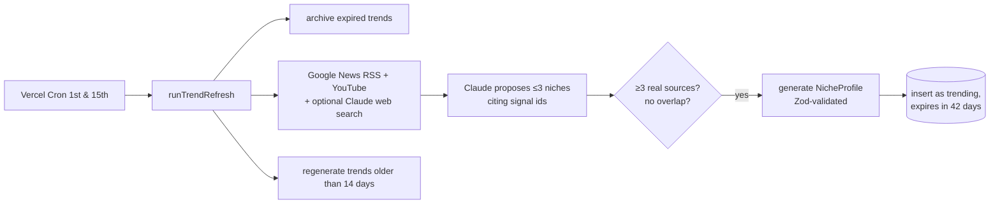

# subcult architecture

Key decisions and the trade-offs behind them. The README covers setup; this file covers _why_.

## Aggregate by link, don't host

subcult curates and links out (Spotify, YouTube, news, shops, social search). It never stores
or re-serves third-party content. That keeps it within every platform's terms, avoids storage
and moderation cost, and means a dead API degrades one section instead of the product.

## Data sources (verified October 2026)

| Section   | Source                                           | Fallback when unavailable          |
| --------- | ------------------------------------------------ | ---------------------------------- |
| Sounds    | Spotify Web API, Client Credentials, `/search`   | Spotify search + artist deep links |
| Tea       | Google News RSS search (no key)                  | Section hidden                     |
| Watch     | YouTube Data API v3 `search` (recent first)      | YouTube search deep links          |
| Community | **Deep links only** to the niche's subreddits    | n/a (no API involved)              |
| Drip      | Generated store search links                     | n/a                                |
| Moodboard | Pinterest / Instagram / TikTok search deep links | n/a                                |

**Reddit: no fetcher.** Reddit closed self-service API access in November 2025, shut off
unauthenticated `.json` endpoints in May 2026, and stops accepting new public API requests on
31 October 2026. The Community tab is designed as deep-link cards (top of the week, search
within the subreddit) instead of fetched posts. Nothing to break, nothing to rate-limit.

**Spotify: search only.** February 2026 development-mode changes require the app owner to have
Premium, cap `/search` at `limit=10`, and remove artist top tracks, new releases and browse
categories (recommendations and related artists were already gone for new apps). The fetcher
uses Client Credentials plus `/search` exclusively, spreading the 10-result budget across the
profile's `spotifyQueries` and `artists`. Without keys, the Sounds tab renders search and
artist deep links from the same profile data.

**Shops.** Global stores only (Amazon, Depop, Etsy, ASOS, Grailed, Google Shopping). The Amazon
storefront is configurable with `AMAZON_DOMAIN` (default `amazon.com`), with an optional
`AMAZON_AFFILIATE_TAG`.

## Cache-first LLM

A niche profile is generated once, validated with Zod and stored forever, keyed by a normalized
slug. The 30 launch niches are hand-curated JSON in `/data/niches`, bundled with the app, so
they render even if the database is down and cost nothing. Claude is only called for
user-typed niches that don't exist yet.

## Budget guardrails

Designed to run for six months on free tiers plus a one-time $5 of API credit.

- **Global daily cap** on new LLM generations (`LLM_DAILY_GENERATION_CAP`, default 30), counted
  from the `llm_usage` ledger, checked before the per-IP limit. It fails closed: if the ledger
  can't be read, nothing is generated. Users see "the vibe machine is resting" with preset picks.
- **Ledger:** every LLM job (and failure) is a row in `llm_usage` with tokens, attempts, cost and
  duration. `/admin/usage` (HTTP Basic, `ADMIN_SECRET`) shows spend and the cap gauge.
- **Seeds are bundled:** the 30 curated niches ship in the app, so they render (and resolve in the
  API) even when Postgres is unreachable.
- **Keep-alive:** a daily Vercel Cron runs one cheap query so the free Supabase project never
  pauses.

## Trend engine

Every two weeks the catalog picks up niches that are emerging right now.

- **Evidence is enforced in code, not trusted from the model.** Claude cites signal ids; anything
  citing fewer than three real, distinct signals is rejected. Signal titles are fenced and treated
  as data, so a headline can't instruct the model.
- **Overlap detection** stems aesthetic suffixes ("-core", "girlies", "cowgirl/cowboy") and
  compares token sets against every existing slug and `relatedNiches`, so renamed variants of
  existing niches don't get published as "new".
- **Cost cap:** every LLM job reserves a conservative estimate against `TREND_RUN_MAX_COST_USD`
  (default $0.25) before running, so even concurrent jobs can't overshoot. Actual costs settle the
  reservation and land in `llm_usage`.
- **Lifecycle:** `kind` (evergreen | trending) and `status` (active | archived | hidden). Trends
  expire after `TREND_TTL_DAYS` (42) and become archived: reachable by URL, gone from Explore.
  Admins can hide any non-seed niche from `/admin/niches`.
- **Scheduling:** Vercel Hobby allows one cron run per day and 300s functions. A run (signals,
  one proposal call, three parallel generations, a few refreshes) fits comfortably; the pipeline
  also stops starting new jobs after 240s and leaves remaining refreshes for the next run. That
  keeps everything on Vercel, so the repo doesn't depend on GitHub Actions schedules, which GitHub
  disables after 60 days without activity.
- **No key, no problem:** without `ANTHROPIC_API_KEY` the cron route no-ops. The
  `/refresh-trends` Claude Code command does the same job by hand (web research → validated
  `data/trends/*.json` → `pnpm trends:upsert`).

## Live feeds, caching and ranking

Each niche page fans out to every configured source in parallel (`Promise.allSettled`), each
behind a 4s timeout and a Redis cache. A failing, slow or unconfigured source is reported and
skipped; the page always renders, and every tab falls back to curated deep links.

| Source  | API                                  | Fresh | Stale-if-error | Notes                                   |
| ------- | ------------------------------------ | ----- | -------------- | --------------------------------------- |
| News    | Google News RSS (no key)             | 1h    | 24h            | last 14 days                            |
| Spotify | Client Credentials + `/search` (≤10) | 24h   | 7d             | playlists by query, tracks by artist    |
| YouTube | Data API v3 `search`                 | 6h    | 3d             | 4-20 min only (no Shorts), daily budget |

**Cache:** Upstash Redis, key `subcult:feed:v3:<source>:<slug>`, value `{ value, fetchedAt }`.
Fresh entries are served directly; expired ones are refetched; if the refetch fails the stale copy
is served instead. A broken cache behaves like a miss, never an error. Without Redis, an in-memory
cache stands in.

**YouTube quota:** search costs 100 of 10,000 daily units, so a shared Redis counter caps feed
searches at 80/day. Past the cap the fetcher stops and the stale cache covers the gap.

**Ranking:** `score = relevance × recencyDecay × sourceWeight × (1 + feedbackBoost)`

- relevance = 0.4 + 0.6 × min(1, keyword hits / 2), with keywords from the niche's name, vibe
  words, artists and brands. News and videos with zero hits are demoted to 0.15.
- recencyDecay = 0.5 ^ (age / half-life): news 48h, video 7d; Spotify items are timeless (0.7).
- sourceWeight: Spotify 1.0, YouTube 0.9, news 0.8.
- feedbackBoost ∈ [-1, 1] from saves and "not my vibe" (Phase 6); −1 removes an item.

The For You feed interleaves sources so no source appears more than twice in a row.

## Database connections

- `DATABASE_URL` is Supabase's transaction pooler (port 6543) with `prepare: false`;
  migrations use `DIRECT_URL` (session pooler, 5432).
- Pool of 3 connections per instance: postgres.js pipelines queries beyond the pool size, and a
  burst of ~5 pipelined queries on a cold single connection hangs behind the transaction pooler
  (reproduced). Three real connections avoid it.
- Niche pages render per request (not prerendered at build), with the profile lookup memoized per
  request and a 2.5s DB timeout before falling back to the bundled seed JSON.
- Functions run in `bom1` (Mumbai), next to the Supabase and Upstash instances.
