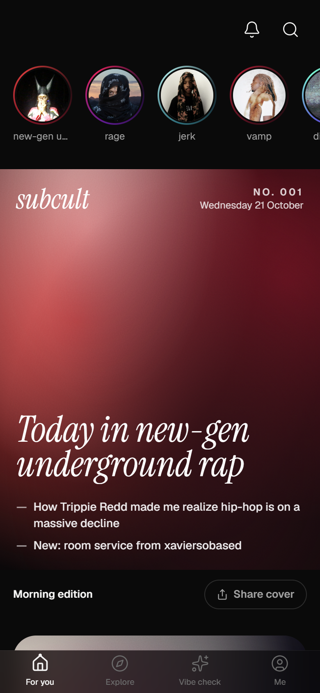
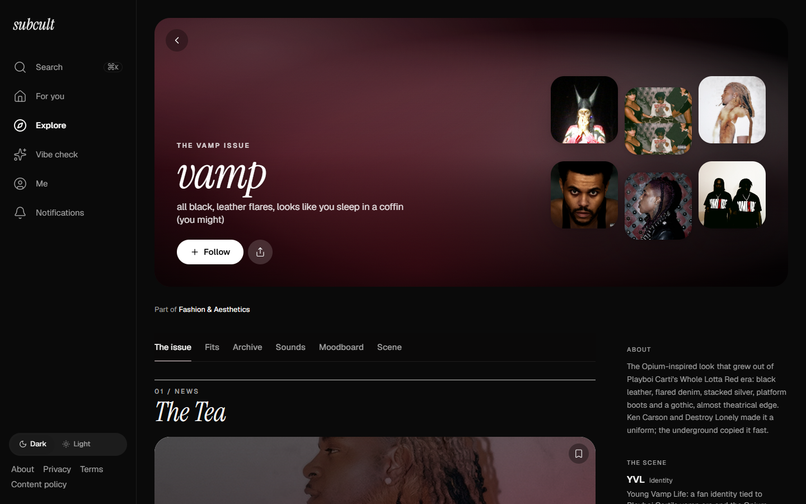
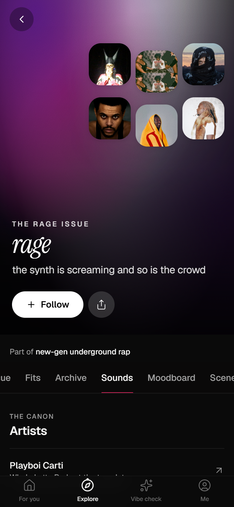
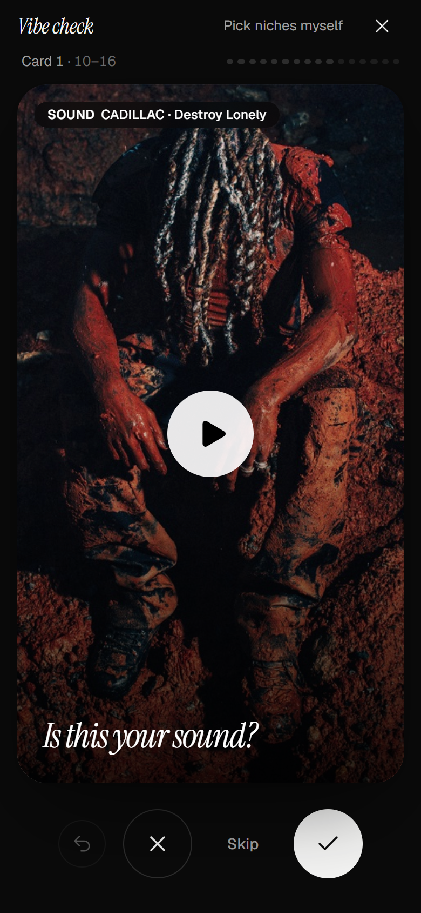
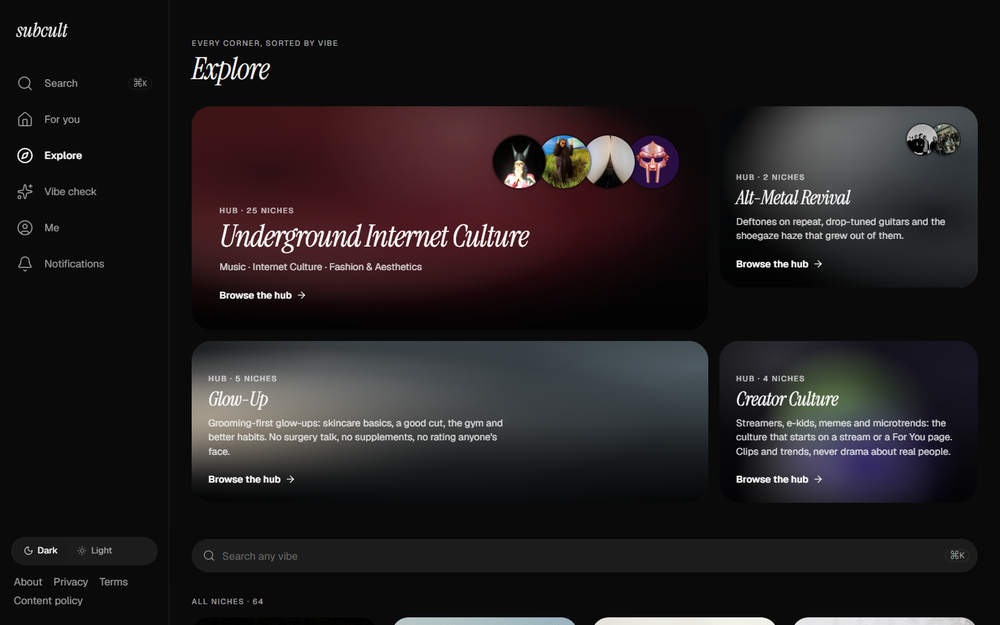
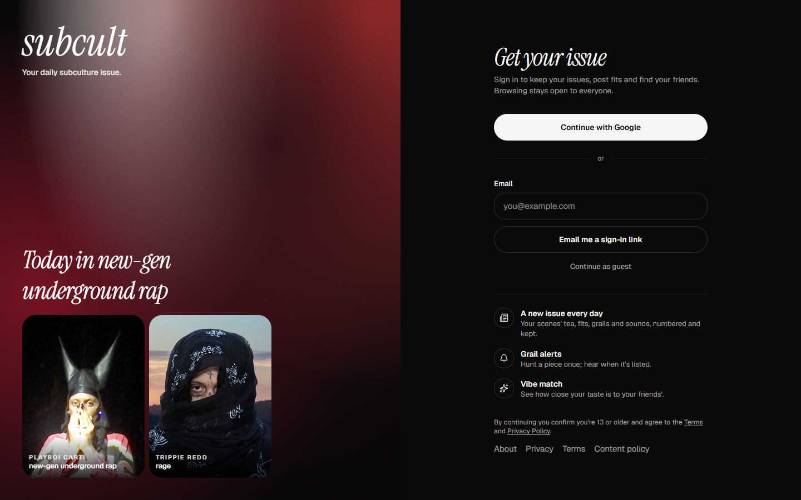
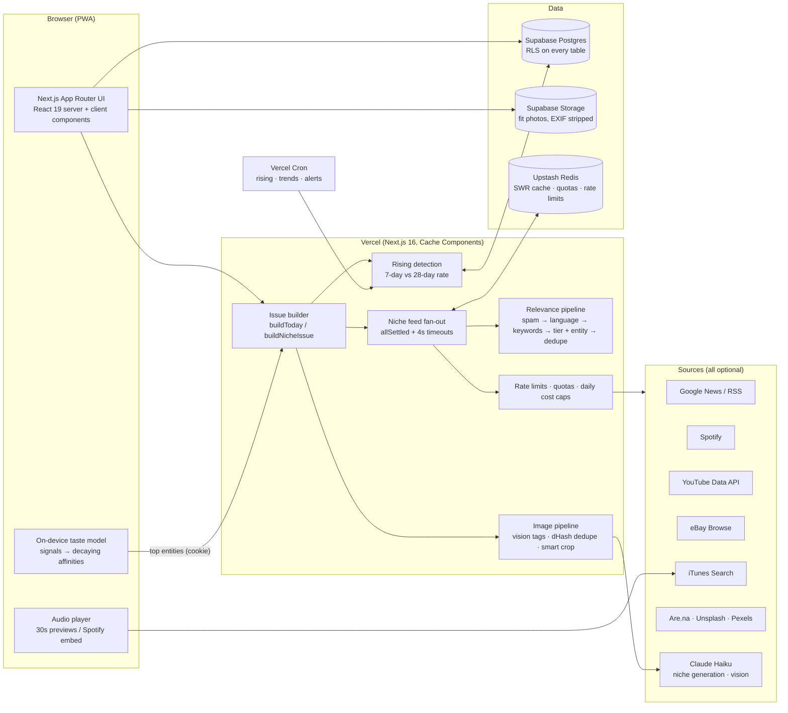

# subcult

**A daily magazine for your subculture.** Pick your scenes (rage, vamp, archive fashion, nu-gaze
and 60 more) and every morning subcult builds you a numbered issue: the tea, the fits, the grails,
the sounds and what's rising, all linking out to where the content lives.

**Live:** _link coming with the launch deploy_

<!-- Demo GIF (30–60s): record it with docs/DEMO-SCRIPT.md, save as docs/demo.gif, then replace this line with  -->

> _Demo GIF goes here. The shot list is in [docs/DEMO-SCRIPT.md](docs/DEMO-SCRIPT.md)._

| Today's issue                                               | A niche page                                           | Sounds                                                   |
| ----------------------------------------------------------- | ------------------------------------------------------ | -------------------------------------------------------- |
|    |       |  |
| **Vibe check**                                              | **Explore**                                            | **Sign in**                                              |
|  |  |    |

## What it does

- **The issue:** each person's daily edition, in magazine order (The Tea, The Fit, The Grail,
  The Sound, The Scene), with a cover, a lead story and a back page. Every issue is numbered and
  kept.
- **Vibe check:** a swipe deck of real content from today. A couple of minutes of swiping becomes a taste profile
  and a shareable result card.
- **Niche pages:** 64 scenes, each with its own palette, fits, archive listings, sounds,
  moodboard and a Scene of verified artists and brands.
- **Social:** fits with Cop or Drop votes, grail alerts by push, Vibe Match between friends.
- **Universal search (⌘K):** niches, artists, brands with live listing counts, playable tracks,
  fits and headlines.

## Architecture



Every source is optional. With no keys the app still runs end to end on the free sources (news,
iTunes, Are.na) and designed fallbacks; adding a key is all it takes to switch a feature on
(`pnpm run doctor` shows what's live, [docs/KEYS.md](docs/KEYS.md) explains each one).

## Engineering

### Taste model

Implicit signals (play, play-through, skip, save, like, share, dwell, open, "not my vibe",
vibe-check picks, follows) each carry a weight. An entity's affinity is
`Σ weight × strength × ½^(age / 14 days)`, so taste follows what you do now, not last year. It's
pure and explainable: every personalized card can say which signal put it there ("because you
saved…").

Ranking is `base score × affinity × novelty`, but items only trade places with items of the same
kind, so personalization never breaks the mix rules (music cap, news share). About 15% of pages
come from niches two hops away, so taste doesn't collapse into one thing. The model lives on the
device for guests and syncs to the account after sign-in. Code: `src/lib/taste/`.

### Issue builder

`buildToday` gathers candidates from the reader's niches and hands them to a pure assembler
(`src/lib/today/edition.ts`). The assembler picks a cover, fills five sections in fixed magazine
order, keeps an issue between 15 and 25 items, and adapts to morning, day, night and weekend
editions. The cover has to earn its place: a vision-tagged fit or grail at 1200px or more, else
the lead story's image, else a generated palette cover. Heavy news (injuries, violence, legal
cases) is never the cover or the lead. Niche pages reuse the same builder, scoped to that niche.

### Rising detection

Rising is computed from dated events (headlines, releases, uploads, and saves and plays inside
subcult), weighted by source: a release counts 3, a headline 1. An entity is rising when its
daily rate over the last 7 days beats its rate over the 28 days before:

- smoothing of 0.25 events a day, so one headline after silence isn't "∞× rising";
- at least 3 weighted events this week and a 1.5× ratio;
- score `log2(ratio) × √volume`: rising and not a one-off.

Only events that match the entity itself count, which a regression test checks. A niche's Scene lists only
its verified entities, plus a labeled "Nearby" group. It runs daily from Vercel Cron. Code:
`src/lib/rising/`.

### Relevance pipeline

Every niche feed goes through one pipeline before ranking:

1. Spam.
2. Language and region.
3. Negative keywords.
4. Source tier plus entity match: open-web items must name one of the niche's verified artists or brands.
5. Dedupe by canonical URL, YouTube video id, or near-identical titles by token Jaccard.

It runs **on read**, so a fix applies to items already in the cache. Tracks are deduped by
Spotify ID in every view, and a story's music sticker never repeats a Sound frame. Code:
`src/lib/feed/clean.ts`.

### Image pipeline

- **Vision tagging:** Claude Haiku sorts moodboard images into fit, product, album art, artist
  portrait or moodboard. It also scores quality and fit to the niche, and writes alt text, six images per request. Anything
  under quality 3 is never a cover or a fit.
- **Resolution per slot:** hero and cover need 1200px or more, cards 600px. The best variant is
  requested from each CDN (Spotify, YouTube maxres, mzstatic and eBay size rewrites).
- **Perceptual dedupe:** a 64-bit dHash (9×8 greyscale with sharp) per image. A Hamming distance
  of 10 or less counts as the same picture, so the same photo at two sizes or crops shows once.
- **Smart crop:** sharp's attention strategy finds the subject, which becomes the CSS
  `object-position`.
- **Mosaics** mix kinds and allow at most 2 album covers.
- Facts (size, hash, focus) are cached in Redis for 30 days, so measuring is almost always
  instant. Code: `src/lib/images/`.

### Caching and quotas

- Each source fetcher sits behind a stale-while-revalidate cache (Upstash Redis, or memory
  locally). It has its own fresh and stale windows and a 4-second timeout, and fan-out uses
  `Promise.allSettled`, so one slow or broken source never breaks a page.
- A Spotify rate-limit block is shared across serverless instances through Redis.
- Next.js Cache Components keep the static shell prerendered and stream the dynamic parts.
- Every API route is rate-limited per IP or guarded. Uploads are size- and type-checked, and
  photos are EXIF-stripped.

### Cost guardrails

Nothing paid or quota-limited runs without a ceiling, and `/admin/status` lists each cap with
what's left today:

| Service           | Cap                                                   |
| ----------------- | ----------------------------------------------------- |
| Anthropic         | Daily caps on niche generations and on vision batches |
| YouTube Data API  | 80 searches a day (of 10,000 units)                   |
| eBay Browse       | 4,000 calls a day (eBay's default is 5,000)           |
| iTunes Search     | 60 a minute per IP; misses cached for a day           |
| Unsplash / Pexels | Cached per niche, under each free tier's hourly limit |

`pnpm run security:audit` checks the rest: RLS is on for every table, every route is limited,
and no server secret appears in client JavaScript.

## Stack

Next.js 16 (App Router, Cache Components, Turbopack) · React 19 · TypeScript (strict) ·
Tailwind CSS v4 · shadcn/ui on Base UI · Motion · Supabase (Auth, Postgres, Storage) · Drizzle
ORM · Upstash Redis · Anthropic SDK (Claude Haiku) · sharp · Zod · web-push · PostHog ·
Vitest · Vercel

## Run locally

```bash
pnpm install
cp .env.example .env.local   # every key is optional; see docs/KEYS.md
pnpm db:migrate              # only if DATABASE_URL is set
pnpm dev                     # http://localhost:3000
pnpm run doctor              # which services are on, and why the rest are off
```

| Script                    | What it does                                                    |
| ------------------------- | --------------------------------------------------------------- |
| `pnpm dev`                | Next.js dev server (Turbopack)                                  |
| `pnpm build`              | Production build                                                |
| `pnpm typecheck`          | `tsc --noEmit` (strict)                                         |
| `pnpm lint`               | ESLint                                                          |
| `pnpm test`               | Vitest (700+ unit tests)                                        |
| `pnpm run doctor`         | Service on/off table with the reason for each                   |
| `pnpm run test:security`  | Two-account abuse tests against the real database (rolled back) |
| `pnpm run security:audit` | RLS, rate limits, and secrets in the client bundle              |
| `pnpm run previews:rate`  | Music preview match rate on featured niches                     |

More docs: [KEYS.md](docs/KEYS.md) (every key, step by step) ·
[MONITORING.md](docs/MONITORING.md) · [deploy.md](docs/deploy.md) ·
[METRICS.md](docs/METRICS.md).
